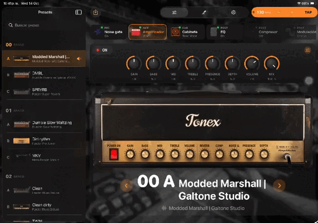

# TonexDirect (iPad, sin ESP32)

<p align="center">
  
</p>

App en SwiftUI para controlar un **Tonex Pedal** conectado **directamente por USB-C** a un iPad con chip M (M1 o posterior, incluido el M3). No necesita el ESP32 ni WiFi.

```
iPad (app TonexDirect) ──IOKit──► TonexDriver (DriverKit, dentro de la app) ──USB CDC──► Tonex Pedal
```

iPadOS no deja que una app abra directamente un puerto serie USB. En los iPad con chip M, una app sí puede incluir un **driver de DriverKit**, y el driver es el que se encarga del puerto USB. Esta app trae uno, `TonexDriver`, que:

- se engancha a las interfaces 0 y 1 del pedal ("ToneX Control VCOM", el puerto CDC que usa el ESP32),
- configura la línea igual que el firmware (115200 8N1, DTR/RTS),
- pasa los bytes entre la app y el pedal.

El protocolo (tramas 0x7E con CRC, hello, estado, nombres de presets, parámetros y config global) se portó a Swift desde `source/main/usb_tonex.c`.

> Esto **no está probado en hardware**. Se escribió sin Xcode a mano. El C++ del driver pasó una revisión de sintaxis, pero el Swift no se ha compilado. Lo más probable es que algunos nombres de la API de USBDriverKit necesiten ajustes la primera vez que compiles (abajo hay una lista).

## Requisitos

- iPad con chip M y iPadOS 17 o posterior.
- Xcode 16 o posterior en una Mac.
- Una cuenta de Apple Developer. Para firmar drivers en desarrollo Apple no pide aprobación previa, pero DriverKit normalmente requiere un equipo de pago (con un "Personal Team" gratuito no aparece la capacidad).
- Un cable USB-C a USB-B (o un adaptador) para el Tonex Pedal.

## Abrir el proyecto

`TonexDirect.xcodeproj` ya trae los dos targets:

- **TonexDirect**: la app (SwiftUI). IOKit entra por `TonexDirect/TonexDirect-Bridging-Header.h`.
- **TonexDriver**: el driver DriverKit, embebido en la app. Enlaza `DriverKit.framework` y `USBDriverKit.framework`.

En cada target, en *Signing & Capabilities*, elige tu Team. Corre el esquema **TonexDirect** en el iPad.

## Primera ejecución

1. Corre la app en el iPad desde Xcode.
2. Conecta el Tonex Pedal al USB-C del iPad.
3. En el iPad, ve a **Ajustes › General › Drivers** (o **Ajustes › TonexDirect › Drivers**) y **activa TonexDriver**.
4. Desconecta y vuelve a conectar el pedal, y abre la app.

La app busca el driver cada segundo. Cuando lo encuentra, lee los 150 presets (unos segundos, verás "Leyendo presets n/150"), luego el preset actual y la configuración global.

## Qué hace

Lo mismo que la versión con ESP32, ahora por USB:

- **Escenario:** el preset actual en grande, botones anterior/siguiente y la lista de presets con búsqueda. La pantalla no se apaga mientras está conectado.
- **Efectos:** amp, gabinete/VIR, gate, compresor, EQ, modulación, delay y reverb del preset activo. Los sliders limitan la tasa de envío y siempre mandan el valor final.
- **Ajustes:** master volume, input trim, BPM, afinación de referencia y bypass de cab sim. Bypass, direct monitor y tempo source no se muestran porque el firmware original tampoco los soporta en el Pedal.

Si cambias de preset en el pedal, la app lo refleja.

## Si no conecta

- **"Conecta el Tonex Pedal por USB-C" aunque esté conectado:** el driver no está activado, o no se enganchó a las interfaces. Revisa el paso 3 de *Primera ejecución*.
- **Para ver qué hace el driver:** conecta el iPad a la Mac, abre **Consola**, selecciona el iPad y filtra por `TonexDriver`. Ahí salen las interfaces que encontró, los endpoints y el resultado de SET_LINE_CODING.
- **Si el driver nunca arranca,** es posible que las interfaces del pedal no sean la 0 y la 1. Conecta el pedal a la Mac y corre:
  ```
  ioreg -rc IOUSBHostInterface -l -w0 | grep -E "ToneX|bInterfaceNumber|bInterfaceClass"
  ```
  La interfaz CDC de control es la de clase 2 y la de datos la de clase 10. Ajusta `bInterfaceNumber` en `TonexDriver/Info.plist`.

## Ajustes probables al compilar

Los nombres siguientes vienen de la documentación y los foros de Apple, pero no se pudieron comprobar contra el SDK:

- `IOUSBHostPipe::Abort(kIOUSBAbortAsynchronous, …)`: si la constante no existe, usa `1`.
- `IOUSBHostInterface::DeviceRequest(bmRequestType, bRequest, wValue, wIndex, wLength, buffer, &bytes, timeout)`.
- `IOUSBGetNextEndpointDescriptor` y `IOUSBHostFreeDescriptor`: si no los encuentra, agrega `#include <USBDriverKit/AppleUSBDescriptorParsing.h>`.
- En la app, `import IOKit`, `IOServiceNameMatching`, `IOConnectCallMethod` y `kIOMainPortDefault` están disponibles en iPadOS 16+ con el entitlement `communicates-with-drivers`.

## Limitaciones

- **Solo Tonex Pedal** (USB 0x1963:0x0068). El Tonex One, el One+ y el Plug usan el mismo framing pero mensajes distintos (slots A/B/C, otros marcadores). Para agregarlos hay que portar `usb_tonex_one.c` (y los demás) y sumar sus personalidades al `Info.plist` del driver.
- **Distribución:** en desarrollo funciona con tu firma. Para TestFlight o la App Store, Apple tiene que aprobar el entitlement *DriverKit USB Transport* para el vendor ID 0x1963 (IK Multimedia), y como no es tu vendor ID puede que no lo aprueben. Para uso personal, basta con instalarla desde Xcode.
- El driver solo toma las interfaces CDC. El audio USB del pedal sigue a cargo del driver de audio de iPadOS.
- Guardar presets en el pedal no está implementado (el firmware tampoco lo hace en el Pedal).

## Estructura

```
TonexDirect/
  TonexDirectApp.swift              App, pestañas y aviso de conexión
  Model/ControllerStore.swift        Máquina de sincronización y estado (@Observable)
  USB/TonexDriverConnection.swift    Puente IOKit al driver + hilo de lectura
  Protocol/TonexFraming.swift        Tramas 0x7E, CRC-16, reensamblado del flujo
  Protocol/TonexPedalProtocol.swift  Mensajes del Tonex Pedal (port de usb_tonex.c)
  Protocol/TonexParamTable.swift     Rangos por defecto (port de tonex_params.c)
  Protocol/TonexParameters.swift     Índices y catálogo de la UI
  Views/                             Escenario, Efectos, Ajustes, controles
  Settings.bundle                    Para que aparezca "Drivers" en los ajustes de la app
TonexDriver/                         Driver DriverKit (target propio)
  TonexControlInterface.*            Interfaz 0: line coding + DTR/RTS
  TonexDataInterface.*               Interfaz 1: bulk IN/OUT, crea el user client
  TonexUserClient.*                  Selectores write/read/status para la app
  TonexBridge.*                      Buffer circular y escritura compartidos
  TonexShared.h                      Constantes compartidas con la app
  Info.plist, TonexDriver.entitlements
Support/TonexDirect.entitlements     communicates-with-drivers
```

## Licencia / atribución

El protocolo, los índices y los rangos vienen de [TonexOneController](https://github.com/Builty/TonexOneController) (Apache 2.0, Greg Smith; parte del protocolo es de [vit3k/tonex_controller](https://github.com/vit3k/tonex_controller)). Los créditos están en la pantalla de Ajustes. No uses las imágenes de amplificadores del repo (son de IK Multimedia).
